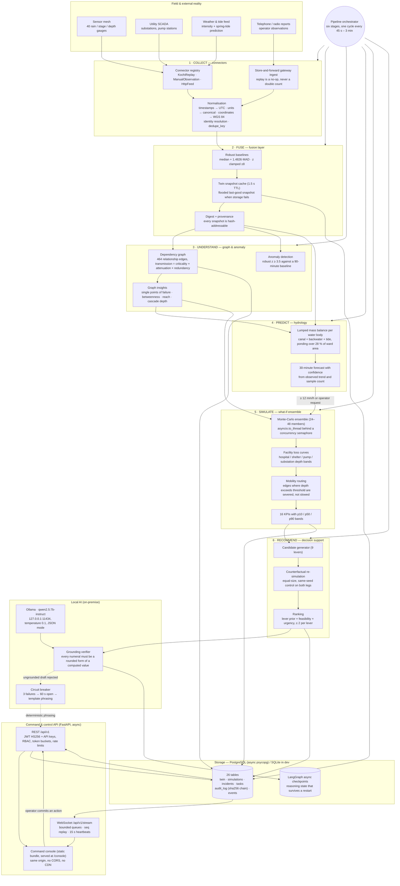
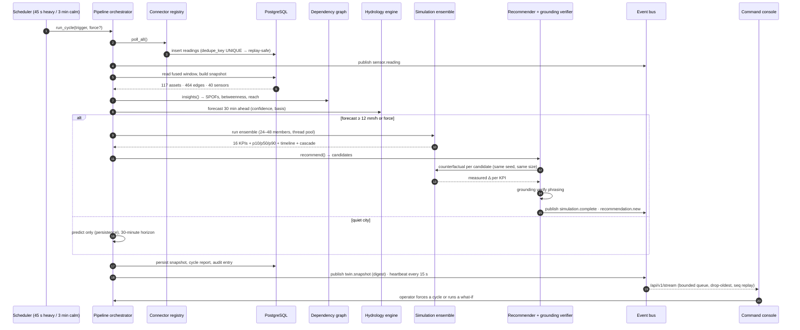
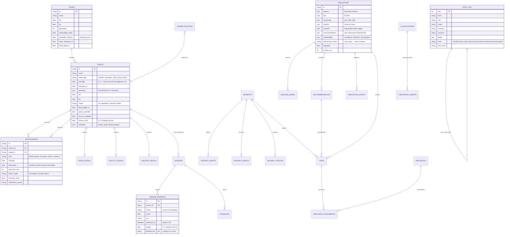
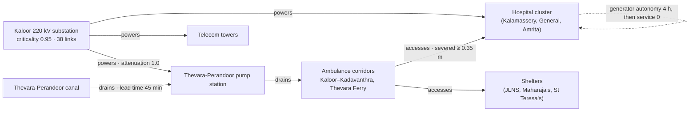
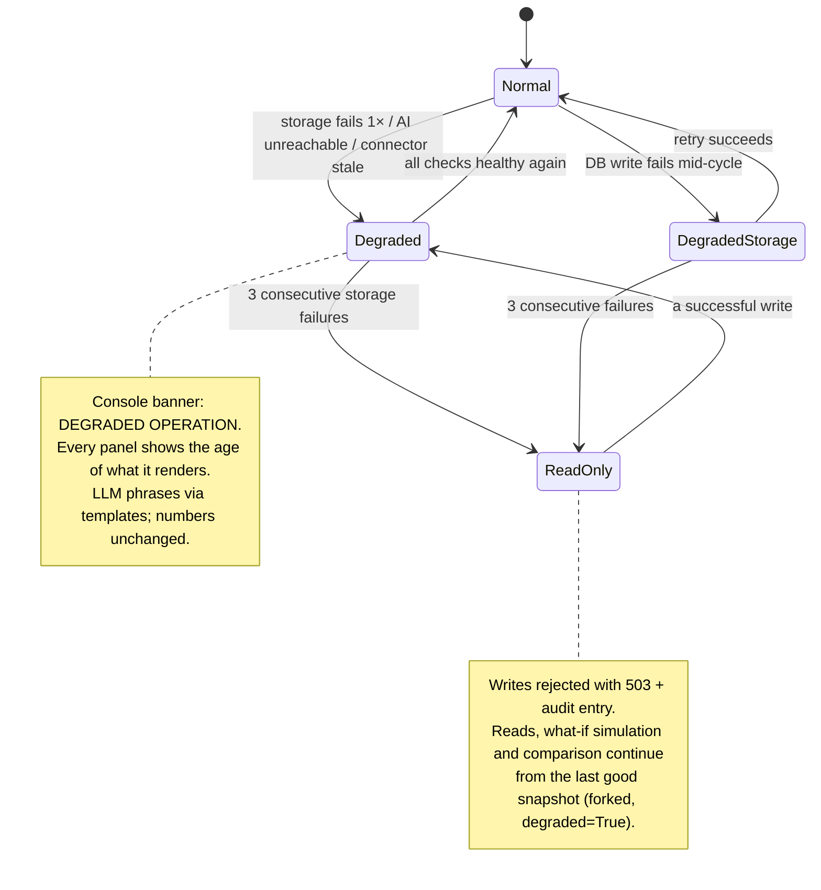
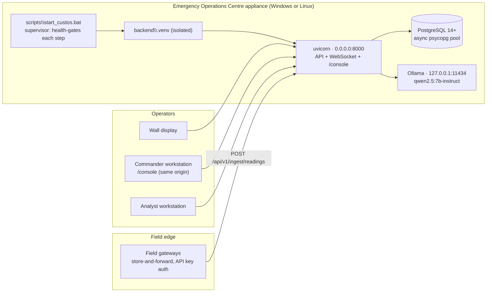

# CUSTOS — System Architecture

> **One city. One appliance. Six stages: Collect → Fuse → Understand → Predict → Simulate → Recommend.**

CUSTOS is a *Crisis Digital Twin*. It exists to move an Emergency Operations Centre
from reacting to a flood to pre-empting it: the same water is modelled hours before
it arrives, the dependencies that turn a flooded road into a blacked-out hospital
are computed explicitly, and every recommendation carries the counterfactual run
that justified it.

This document is the map of the system. Everything here is implemented; the
repository is the authority when the two disagree.

---

## 1. End-to-end architecture

### Why the arrows point that way

| Decision | Reason |
| --- | --- |
| The **pipeline orchestrator is the only writer** of stage state, twin snapshots and cycle reports | One writer means the console can never disagree with the backend about what ran, and every stage carries its own `status`, `detail`, timestamps and degradation flag. |
| **Storage failure forks the last good snapshot** rather than raising | A database hiccup during a flood must not blind the console. The snapshot is marked `degraded=True`, the API emits `X-CUSTOS-Degraded`, and the UI says so in the banner. |
| The **LLM is a leaf, never a source** | The model can only rephrase text that engines produced. The grounding verifier re-checks every numeral (2 % relative / 1 absolute, precision-aware) and a rejected draft is logged, audited and replaced by a template. A model outage changes the wording, never a number. |
| The console is a **static bundle served by the API at `/console`** | Air-gapped operation: one process, one port, no CORS, no CDN, no tile server. The map is drawn from the twin's own geometry. |

---

## 2. The six-stage cycle

---

## 3. Data model (Crisis Digital Twin)

`backend/schema/custos_schema.sql` (PostgreSQL DDL) and `backend/schema/schema.prisma`
are generated from the same models and verified in CI by
`python backend/scripts/export_schema.py --check`.

---

## 4. Dependency graph — the reason CUSTOS is not a dashboard

Transmission along an edge is
`criticality × attenuation × (0.55 + 0.45·criticality_of_source) × max(0.28, 1/(1 + 0.55·healthy_alternatives))`
and maps to bands: **≥ 0.85 FAILED, ≥ 0.60 IMPAIRED, ≥ 0.35 DEGRADED**.
`MONITORS` edges carry knowledge only — a sensor losing power does not disable the
pump it watches, and the model says so rather than inventing a cascade.

Two-hop reachability is what makes the Kaloor substation the city's real
vulnerability: losing it impairs 55 assets within 3.5 ms of graph traversal,
including three hospitals, before the flood has reached them.

---

## 5. Resilience: what happens when things break

| Failure | Behaviour | What the operator sees |
| --- | --- | --- |
| Database unreachable | Snapshot forks from last good state, `degraded=True` | Amber banner, `X-CUSTOS-Degraded: true`, per-panel ages |
| 3 consecutive DB failures | Health mode → `READ_ONLY`; writes refused | Red banner; reads, what-if and comparison still work |
| Ollama unreachable | Circuit opens 60 s, template phrasing | "local model offline" chip; **numbers unchanged** |
| Sensor mesh silent | Reading ages rise; quality score decays | Sensor age column; stale-sensor count on the rail |
| Network to the browser | WebSocket reconnects with jittered backoff, resumes from `seq` | "feed down" chip, reconnect count, gap repair notice |
| Event ring exhausted | Heartbeat reports the window; console refetches the twin | "gap repaired" chip — never a silent hole |
| Language model emits a fabricated figure | Grounding verifier rejects the draft, logs it, falls back | "template fallback used" in run evidence |

---

## 6. Deployment topology (single appliance, air-gap friendly)

No component requires the public internet: the map is drawn from the twin's own
geometry, the fonts are system fonts, and the language model runs on the same box.

---

## 7. Security posture

| Control | Implementation |
| --- | --- |
| Authentication | JWT HS256 (`aud=custos-ui`) for operators; per-user salted sha256 roster entries (`subject:hash$salt:role`); API keys (`key:role`) for ingest, compared with `hmac.compare_digest` |
| Authorisation | Four roles (`viewer`, `analyst`, `commander`, `admin`) mapped to capabilities; the console hides what a role cannot do and the API refuses it anyway |
| Brute force | 8 failures per subject per 300 s triggers lockout; constant-time decoy comparison so user enumeration is not possible |
| Rate limiting | Per-identity token bucket; 429 responses carry the correlation id |
| Transport | Same-origin console; `CORS` allow-list is explicit in production and only loosened in development |
| Secrets | Never in git: `.env.dev` is generated locally from `.env.dev.example`, with a fresh JWT secret and freshly salted rosters |
| Audit | Append-only sha256 chain (`prev_hash` → `hash`), sequence numbers assigned in-process, verified on demand and on every health check; a tampered row is detectable at an exact `seq` |
| Grounding | The LLM cannot introduce a number; rejected drafts are persisted with the prompt digest in `ai_invocations` |
| Input handling | Pydantic models at every boundary; unit, timestamp and coordinate normalisation before storage; unknown fields rejected rather than ignored |
